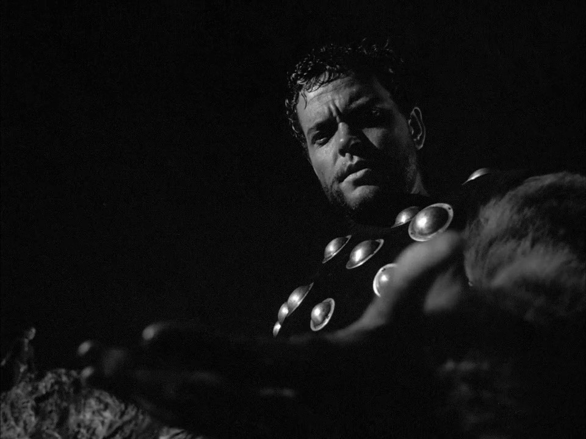
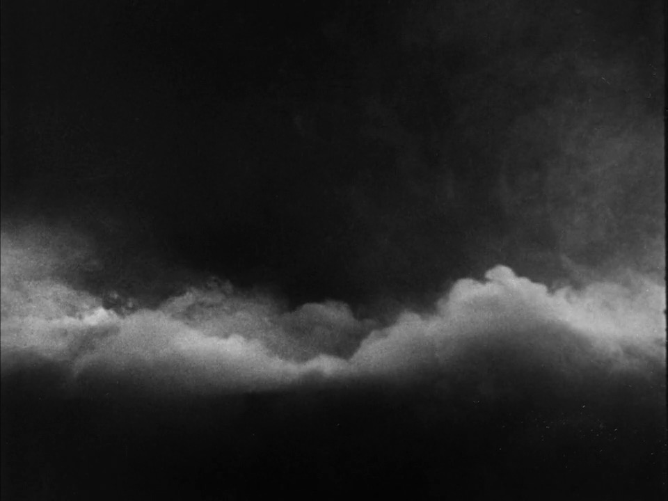
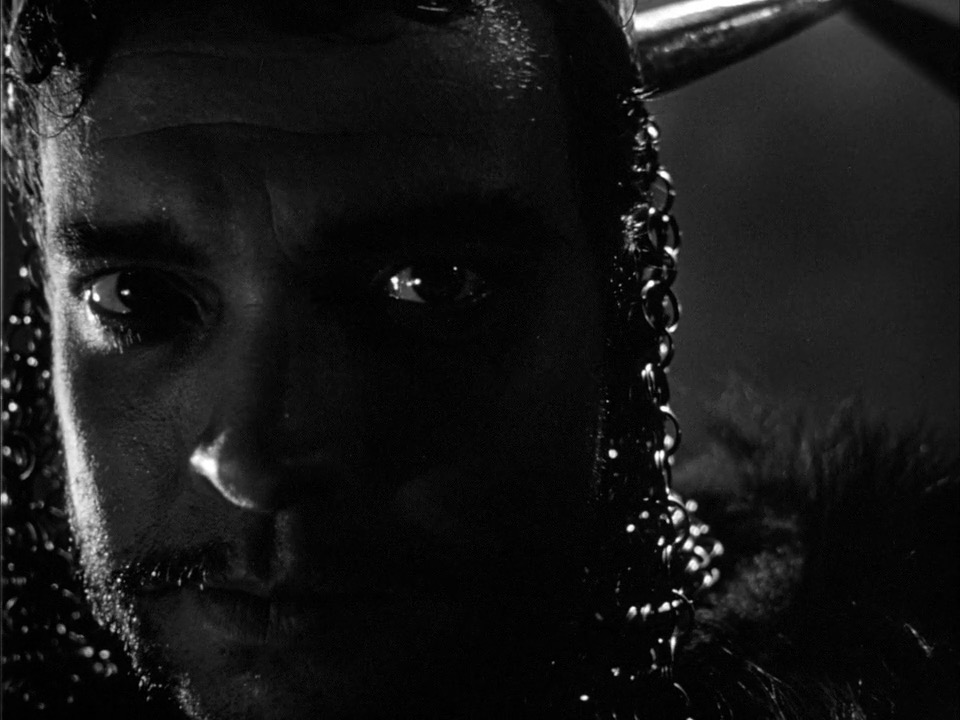

Where is Shakespeare at his most powerful? Reliably captivating across his plays are his dramatic tension, imaginative worldbuilding, moral depth, and other triumphs. But what endures most prominently in my memory of Shakespeare tends to be those few lines which, perhaps even seeming superfluous at first, paint images that densely pack meaning into such a small package. These poetic images, however, can come second to what a director’s first instinct may be when filming Shakespeare: adorning the film with the splendor of everything a camera can show, displaying period environments ranging from grand castles to bustling markets. But Grigori Kozintsev, in his essay “‘Hamlet’ and ‘King Lear’: Stage and Film,” stresses that in Shakespeare films, “\[t\]he aural has to be made visual. The poetic texture itself has to be transformed into a visual poetry, into dynamic organisation of film imagery.”1 Kozintsev’s task was taking these poetic images and rendering their impact filmically. His approach embodies what Jack Jorgens calls “\[t\]he filmic mode, … the mode of the film poet.”2

Kozintsev is not the only Shakespeare film poet. Orson Welles, in his *Macbeth* (1948), plays the titular character, an intensely ambitious—yet conscientious—Scottish noble who first murders the king and then other innocent victims in a usurpation of the Scottish throne. Alongside Welles, Jeanette Nolan plays Lady Macbeth, who goads Macbeth on against his moral reservations, fueled by a cold ambition of her own. As director, Welles combines visual poetry and aural poetry at multiple of those textual moments of densest meaning. In doing so, Welles augments the impact of Shakespeare’s poetic images. However, Welles, like a true film poet, also goes beyond Shakespeare’s images to create some of his own. The three examples of Welles’s filmic poetry I will explore in this article show the power of the filmic mode, especially when combined with Shakespeare.

**“Incarnadining” Beyond the Screen**

To incarnadine, for readers unfamiliar with Shakespeare’s prolific word inventions, means to make red. The Bard uses new diction here to show how Macbeth understands well the moral gravity of murdering King Duncan, not least immediately after he does the infamous deed. Horrified at what he has done, Macbeth asks

Will all great Neptune’s ocean wash this

blood

Clean from my hand? No, this my hand

will rather

The multitudinous seas incarnadine,

Making the green one red.3

Shakespeare’s image is an anti-baptism, one where Macbeth’s guilt, symbolized by his victim’s blood, not only cannot be washed away but, what is worse, taints all pure water. There is a sense of the beyond in Shakespeare’s blood-red sea. In Macbeth’s time, the sea was the border of the known world. Macbeth knows that his culpability will be so total that he can never escape it, for it cannot even be contained within his world’s boundaries.

Welles uses Macbeth’s bloody hand to great effect. He composes the shot of himself speaking the above lines so that his hand, although out of focus, dominates the foreground (Fig. 1). Welles has drawn our attention to Shakespeare’s symbol of guilt. Then, as Welles says, “Making the green one red,” his hand descends below the frame. Welles’s movement of his hand mirrors the Shakespearean image of the bloody hand plunging into the vast seas. But where does Welles’s hand go? When it leaves the frame, its location becomes ambiguous. The hand is not destroyed, but the camera hides it from us. Beyond the aspect ratio, is there an infinite void? Of course, literally, outside of the camera frame remains the hand, as well as the set, cast crew, etc. Is the entire film production incarnadined? Or what if the hand is entering the real world as soon as it leaves the filmic world bounded by the frame? The movie theater, the town, and soon the entire actual world would thus be tainted by Macbeth’s guilt. The answer to this ambiguity is not as important as the ambiguity itself. In fact, it is this uncertainty that makes Welles’s decision so effective. The “multitudinous seas” of the text crash on coasts Macbeth will never see, but they are still finite, contained in his world, realizable in his imagination. We too can visualize an ocean being turned red by the blood spilt in foul play. But we cannot even start to imagine the location and scope of the incarnadining guilt spread by Welles’s corrupting hand. Welles takes advantage of a uniquely filmic contrast, that between what is shown within the frame and what is made ambiguous outside of it. When Welles moves his bloody hand from the former to the latter, we have no idea how far Macbeth’s culpability spreads, and we’re terrified.

Figure 1. Macbeth’s bloody hand in the foreground. Still from *Macbeth,* directed by Orson Welles (Republic Pictures, 1948).

**Denying the Close-Up**

Macbeth's crimes do not end with the murder of King Duncan. Desperate to secure his usurpation, Macbeth violently pursues anyone his paranoia labels a threat. As his ambition transforms him into a callous tyrant, his wife spirals into guilt-ridden mania, which climaxes in her suicide. Seyton, the only Scottish noble to remain loyal to Macbeth, tells the tyrant of his wife’s death, and Macbeth’s reaction haunts the page:

She should have died hereafter.

There would have been a time for such a

word.

Tomorrow and tomorrow and tomorrow

Creeps in this petty pace from day to day

To the last syllable of recorded time,

And all our yesterdays have lighted fools

The way to dusty death. Out, out, brief

candle!

Life’s but a walking shadow, a poor player

That struts and frets his hour upon the stage

And then is told no more. It is a tale

Told by an idiot, full of sound and fury,

Figure 2. The cloudy landscape. Still from *Macbeth,* directed by Orson Welles (Republic Pictures, 1948).

Signifying nothing.4

In the “Tomorrow” speech, Macbeth brushes off his wife’s death as inevitable and trivial while denigrating his own existence. He does so with a series of images that characterize the nihilistic view of life he purports: life’s tedium like personified, creeping, spiteful “tomorrow”; its misdirection through many “yesterdays” along a meandering path toward the death we all incurred by Adam and Eve; its smallness and insignificance like a “brief candle”; its amorphousness as a “walking shadow”; its meaninglessness like an actor with no audience or a story told arbitrarily and thoughtlessly. Whether this is a manifestation of a genuine nihilism overcoming Macbeth or the tyrant’s attempt to manipulate himself by sheer poetic force into moral resignation, thus denying his having moral responsibility and avoiding any attendant psychological turmoil, is a question for another article. What I am concerned with here is the tone of the textual image—that of the zero, of despaired resignation—and how Welles builds upon it filmically.

Welles indeed augments this image also, doing so with a striking decision. Being an adept actor, you might expect Welles to shoot a close-up of his face for the duration of the “Tomorrow” speech. Instead, by the time he says “Tomorrow,” Welles has faded and been replaced by a cloudy landscape (Fig. 2), which Welles sustains for the duration of the speech. In so doing, Welles directs our focus toward the world Macbeth is commenting on, a world of mist and cloud. And as we watch with Macbeth the clouds “\[c\]reep in this pretty pace,” they evoke in their amorphism the “walking shadow” Macbeth attributes to his own life and represent in their vaporousness the “nothing” which Macbeth sees his life constituting. After we understand how Macbeth now views the world, Welles fades to a brief, crushing close-up of the tyrant (Fig. 3).

Figure 3. The crushing close-up. Still from *Macbeth*, directed by Orson Welles (Republic Pictures, 1948).

Denying us the extended close-up is the most effective choice, and somewhat counterintuitively so: we would expect an intimate and moving performance from Welles to be the most compelling presentation. But I hold that the brief moment of seeing Welles’s face carries tremendous weight—more than an extended close-up—precisely because of the 

time spent lingering on the clouds. Welles’s filmic image, through both its resonance with Shakespeare’s text and its profound simplicity, opens his audience’s ears to the “Tomorrow” speech in a way that forces them to reckon with the bleakness of both the film and text. Welles rejects the instinct to show the actor's face, instead presenting a filmic image that both builds upon the text and allows it to more fully breathe.

**A Bell and Noose of Reckoning**

We proceed from two filmic images that are directly inspired by Shakespearean images to one that is more originally Welles’s. Shakespeare lays the textual groundwork, which Welles turns into an indictment against all the evil Macbeth has committed up to his mortal battle against the rebel army from England.

Before revealing Lady Macbeth’s death, Seyton is instructed by Macbeth to “\[h\]ang those that talk of fear,” a moment Welles holds to.5 In Shakespeare’s text, Seyton ambiguously exits the play after this point. However, in Welles’s film, Seyton’s story does not end in mystery. But first it is worth noting that the English army is led by Malcolm and Macduff, the former the son of King Duncan, the latter the patriarch of a family Macbeth heinously murdered. The importance Welles places on the army being led by those whom Macbeth’s treachery most intimately afflicted is manifest in his original filmic image.

Both textually and filmically, the “alarum bell” heralds the arrival of Malcolm's army.6 Simultaneously in his film, Welles shows a hanged man swinging back and forth in the motion of a clapper causing the bell to sound.7 Thus, he reveals Seyton’s fate: the usurper’s most loyal noble hangs himself, perhaps consumed by a mental “talk of fear” that incurs execution by hanging. By associating this image with the sound of the ringing bell, Welles links the substance of the alarm with that of the image. Seyton hanged represents the culmination of the brutality Macbeth stooped to so that he could gain and keep the throne, a brutality that went so far to not only rouse the rebellious vengeance of Malcolm and Macduff but to scare his most loyal follower into despaired suicide. Welles associates this brutality with the direct cause of the alarm’s sounding because Welles sees the alarm, auditory evidence of Macbeth’s imminent downfall, as a representation of the fate awaiting those who resort to criminality to satisfy their ambition. Macbeth actually faces the swinging Seyton and the consequences heralded by the alarm, thus beholding the effects of the transgressions before going off to the battle that is his ultimate demise.

The filmic mode works in Shakespeare films in a special way; poetic images can harmonize with the poetic text or, when original, can cohere well with the essentially poetic nature of any project bringing Shakespeare to film. Welles demonstrates this powerfully with his augmentations of Shakespeare’s textual bloody sea and Macbethian nihilism, as well as with his original, thematically resonant bell whose clapper represents Macbeth’s cumulative cruelty.

Filmic poetry, however, is not bound by Shakespeare nor even by films adapting originally theatrical drama. Any film can enter the filmic mode. A camera can show a great range of experiences with a realism far greater than the theater. But sometimes the most powerful image is not the most realistic or comprehensive rendering of the event but an image that embodies the narrative or thematic weight of the moment; this applies to all films, not just Shakespeare. Recognizing the filmic mode as one of film’s most potent methods unlocks a new front of analysis for viewers, one that will leave you with images that are not just grand or enthralling but poetic.

*N o t e s*

1.  Grigori Kozintsev, “‘Hamlet’ and ‘King Lear’: Stage and Film,” in *Shakespeare 1971*, ed. Clifford Leech and John Margeson (Toronto: University of Toronto Press, 1972), 191.
2.  Jack J. Jorgens, *Shakespeare on Film* (Bloomington: Indiana University Press, 1977), 10.
3.  William Shakespeare, *Macbeth,* ed. Barbara Mowat, Paul Werstine, Michael Poston, and Rebecca Niles (Washington DC: Folger Shakespeare Library, n.d.), accessed September 22, 2026, folger.edu, 2.2.78-81
4.  Shakespeare, *Macbeth,* 5.5.20-31
5.  Shakespeare, *Macbeth,* 5.3.43
6.  Shakespeare, *Macbeth,* 5.5.57
7.  *Macbeth,* directed by Orson Welles, 1:35:41; a high-quality visual still of this specific frame was unavailable.